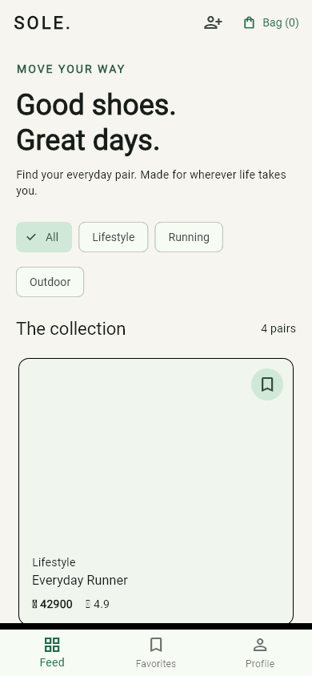

# SOLE — Sneaker Store

Flutter capstone MVP және LAB 5–7: кроссовка таңдауды жеңілдететін мобильді дүкен.
Нысаналы пайдаланушылар — студенттер мен күнделікті аяқ киім іздейтін адамдар.

## Іске қосу

Flutter SDK орнатылған ортада осы қалтадан орындаңыз:

```sh
flutter pub get
flutter run -d chrome
```

Android телефон/эмулятор үшін `flutter devices`, кейін `flutter run -d DEVICE_ID`.

## Мүмкіндіктер

- Discovery: бейімделетін тауар карточкалары, категория сүзгісі.
- Detail: Stack мұқабасы және bookmark белгісі, Row тақырыбы, Wrap баға/рейтинг/тегтер.
- Sticky төменгі жолақ: SafeArea → Row → Expanded → Add to Cart.
- StatefulWidget және setState: таңдаулылар, EU өлшемі, себет саны.
- Bag терезесі: өлшем бойынша саны және жалпы бағасы.
- Offline PNG мұқабалары: жоба ішіндегі векторлық суреттен жасалған, желі қажет емес.

Деректер демонстрациялық. Себет пен таңдаулылар тек ағымдағы сессияда сақталады.
Төлем, REST API, база және BLoC кейінгі кезеңдерде қосылады.

## Құрылым

```text
lib/
  main.dart
  models/product.dart
  screens/discovery_screen.dart
  screens/product_detail_screen.dart
  screens/registration_screen.dart
  screens/profile_screen.dart
  widgets/product_art.dart
test/widget_test.dart
test/registration_test.dart
```

## Тексеру

```sh
flutter analyze
flutter test
flutter build web
```

Widget тесттері 280×568, 320×568, 390×844, 1024×768 және 1440×900 өлшемдерінде
екі экранды ашады, bookmark пен EU 41 өлшемін таңдайды, себетке қосады және
Bag ішіндегі санын тексереді. RenderFlex және басқа Flutter қателері тестті құлатады.
Нақты Android құрылғысында іске қосу бөлек тексерілуі керек.

## 3–5 минуттық қорғау

1. **Pitch (1 минут):** «SOLE студенттерге аяқ киімді категориямен қарап,
   ұнағанын сақтап, өлшемін таңдап, себетке жинауға көмектеседі».
2. **Demo (2 минут):** Discovery → категория → тауар → bookmark → EU 41 →
   Add to Cart → артқа → Bag. Терезе енін өзгертіп, бейімделуін көрсетіңіз.
3. **Code review (1 минут):** screens/widgets/models құрылымын, Stack,
   Wrap, Expanded және setState қолданылған жерлерді көрсетіңіз.
4. **Даму жоспары:** REST каталогы, жергілікті сақтау, BLoC, авторизация және checkout.

## LAB 6 — User Registration & Profile Setup

Discovery үстіндегі **Create account** белгісін басыңыз.

- Form және GlobalKey<FormState> батырма басылғанда барлық өрісті тексереді.
- TextEditingController: Full Name, Email, Password және Confirm Password.
- Full Name бос/тек бос орын болса қабылданбайды.
- Email ішінде @ және домен нүктесі болуы керек; бос орындар мен қате құрылым қабылданбайды.
- Password кемінде 6 таңба; екі пароль өрісі obscureText арқылы жасырылған.
- Confirm Password дәл сәйкес болуы керек. Password өзгерсе, растау қайта тексеріледі.
- AutovalidateMode енгізу кезінде қателерді көрсетеді; submit барлық өрісті тексереді.
- Dropdown: Student / Teacher / Developer.
- Terms and Conditions checkbox белгіленбейінше тіркелу орындалмайды.
- Сәтті submit: terminal/debug console деректері және success SnackBar.
  Парольдер терминалда [REDACTED] деп көрсетіледі.
- Controller ресурстары dispose арқылы босатылады.

Бұл UI демонстрациясы: аккаунт серверде жасалмайды, деректер сақталмайды.
Registration тесттері міндетті өрістерді, live тексеруді, пароль өзгергендегі
сәйкестікті, checkbox талабын, сәтті submit пен рөлді тексереді.
280×568, 390×844 және 1440×900 өлшемдерінде форма overflow бермейді.
Жалпы 10 widget тесті өтті; flutter analyze қате таппады.
## LAB 7 — Navigation & Tabs

- Root экранда **BottomNavigationBar**: Feed / Favorites / Profile.
- Feed төрт тауарды суретімен, атауымен және бағасымен көрсетеді.
- Bookmark басқанда тауар Favorites қойындысына бірден қосылады/алынады.
- Profile: қонақ профилі, сессияда сақталатын баптау және LAB 6 формасына өту.
- IndexedStack және жеке ScrollController қойындылардың күйін сақтайды.
- `Navigator.push` арқылы толық Product объектісі detail конструкторына және
  `RouteSettings.arguments` ішіне беріледі: name, description, imageAsset, price, category, color.
- Detail AppBar Back және экран ішіндегі **Back to collection** батырмалары
  `Navigator.pop(context)` шақырады. Категория, favorites, себет және tab күйі сақталады.
- Product мұқабалары `assets/products/` ішінде, интернетсіз ашылады.

Соңғы тексеру: **14 widget тесті өтті**, lutter analyze --no-pub — қате жоқ,
Web build сәтті. Физикалық Android құрылғысы тексерілмеген.

### Қысқа бейнежазба

[MP4 жазбасын ашу](docs/lab7-navigation.mp4) · [GIF нұсқасы](docs/lab7-navigation.gif)



Бұл 390×844 өлшеміндегі Flutter қолданбасының автоматты UI сценарийінен алынған
нақты рендер кадрлары: Feed → Detail → bookmark → экран ішіндегі Back → Favorites
→ Detail → AppBar Back → Profile → баптау → Feed. Ұзақтығы шамамен 16 секунд.
Физикалық телефоннан түсірілген видео емес.

Жазбаны қайта жасау:

```sh
flutter test tool/record_navigation_test.dart
python -m pip install Pillow imageio-ffmpeg
python tool/encode_recording.py
```
## GitHub

Репозиторий: [ordabekuly/sole-store](https://github.com/ordabekuly/sole-store).
Репозиторий public: код пен README сілтемесі бар кез келген адамға ашық.

```sh
git clone https://github.com/ordabekuly/sole-store.git
cd sole-store
flutter pub get
flutter run -d chrome
```

Келесі өзгерістерді жіберу:

```sh
git add .
git commit -m "feat: describe your change"
git push
```

## LW8 — Smart Catalog

Open **Profile → LW8 Smart Catalog**.

- ListView.separated renders rows lazily; GridView.builder shares the same data.
- The grid has two columns and childAspectRatio: 0.72.
- Pull down either view to refresh. AlwaysScrollableScrollPhysics enables this even for short/empty catalogs.
- Refresh waits 1500 ms, then inserts a uniquely identified product at index 0.
- In List view, swipe right-to-left to delete. Dismissible uses ValueKey(product.id).
- The floating SnackBar offers UNDO, restoring the original index (clamped if the collection changed).
- Empty catalogs show Catalog is Empty and Reset Catalog.
- Reset restores the four original items. Changes are session-only; no server request is sent.

Files: lib/models/catalog_product.dart, lib/widgets/catalog_tile.dart,
lib/screens/smart_catalog_screen.dart, lib/screens/profile_screen.dart.

Defense: builders construct visible children on demand; a large Column constructs all children
at once. A stable ID key identifies the product after removal/insertion, whereas an index key
can refer to a different product when the collection changes. Future.delayed simulates network latency.

## LW9 — Global Cart with Provider

Open **Profile → LW9 Global Cart**. Select from six products, then tap the AppBar
cart badge to open Cart View. Remove one product or Clear All and return:
selection toggles, badge count and total immediately reflect the shared state.

- lib/providers/cart_provider.dart: CartProvider extends ChangeNotifier;
  immutable public item list, count, totalPrice, toggle/remove/clear and notifyListeners.
- lib/main.dart: ChangeNotifierProvider wraps MaterialApp, so pushed routes share
  one provider instance. context.watch rebuilds readers; context.read handles actions.
- lib/screens/global_catalog_screen.dart: six products, selection toggles, live Badge.
- lib/screens/global_cart_screen.dart: selected products, remove buttons, total and Clear All.
- test/global_cart_test.dart: provider behavior, route access, cross-screen sync and
  280/390/1440 layouts. Prices are integer KZT. Selection is session-only, without quantities.

LW9 is a separate teaching flow; the earlier size/quantity-based LAB 5 demo Bag remains separate.
Provider reference: https://pub.dev/packages/provider

## LW10 — Cloud Product Explorer

Open **Profile → LW10 Cloud Explorer**. Live source: https://fakestoreapi.com/products

- http: ^1.2.0; GET with a 10-second timeout, explicit HTTP 404/500/other errors,
  malformed JSON and offline/timeout handling. No bundled products silently replace API failures.
- models/cloud_product.dart defines the API Product separately from the local SOLE Product.
  fromJson accepts integer/double prices and ratings and provides null/type fallbacks.
- services/product_api.dart fetches/decodes data; injectable http.Client supports deterministic tests.
- screens/cloud_products_screen.dart implements Loading / Success / Error + Retry Connection,
  ListView.separated thumbnails and pull-to-refresh, including short/empty feeds.
- screens/cloud_product_detail_screen.dart has ProductDetailScreen, Hero product_image_ID,
  PageView.builder, counter, animated indicators, description, category and sticky Add to Cart.
- Fake Store API provides ONE image per product. The 3 carousel pages are explicitly labelled
  standard/cropped/wide views of that same image, not three independent product photos.
- providers/cloud_cart_provider.dart keeps selected API products in a session cart in USD.
  This is separate from earlier KZT teaching catalogs; it is shared through root MultiProvider.
- Share opens a modal sheet with narxoz://store/product/ID and a Clipboard copy button.
  The lab displays/copies the URI; OS-level deep-link routing is not registered.
- Android INTERNET permission is included in the main manifest, including release builds.

### Defense and offline recovery

1. Open LW10 while online: show spinner then live products, refresh once.
2. Open a product: demonstrate Hero, swipe pages, show counter and dots.
3. Add to Cart, open Share and copy the narxoz link.
4. On a physical phone disable Wi-Fi/mobile data (Airplane mode), then pull to refresh
   or reopen LW10 to force a new request. Show the error and Retry Connection button.
5. Restore the connection and tap Retry Connection; products reload without restarting.

Validation: 37 automated tests passed, analyzer clean. Tests cover numeric JSON,
HTTP 200/404/500/403, timeout (including actual timeout timer), invalid JSON,
loading/error/retry/refresh, disposed-screen responses, Hero, page swipe/counter,
copy sheet and cart at 280/390/1440 screen widths. Actual service live request returned
20 products (`dart run tool/check_cloud_api.dart`). Physical Airplane-mode and browser
CORS behavior were not manually tested. Widget network responses use controlled fixtures.

## LW11 — Offline Notes & Settings Vault

Open **Profile → LW11 Notes Vault**. Enter a username and press Save, toggle Dark Mode,
add notes, use their checkboxes, and delete individual notes. Blank titles cannot be added.

### Architecture

- `main.dart`: ensureInitialized → await VaultProvider.load → runApp.
  MaterialApp selects its first theme from the already-loaded value, avoiding a light
  Flutter frame before a saved dark preference. A startup storage error offers Retry storage.
- `models/note_item.dart`: immutable NoteItem(id, title, dateText, isCompleted), toJson/fromJson.
- `providers/vault_provider.dart`: SharedPreferences bool/string reads with defaults,
  jsonEncode of the full note list and jsonDecode restoration. Mutation methods await
  setBool/setString and check the result before confirming the change in UI.
- `screens/notes_vault_screen.dart`: responsive single-screen settings/notes UI.
- `test/vault_test.dart`: model round-trip, disk-interface mock restoration, corrupted JSON,
  first-frame dark theme, CRUD and name/theme controls at 280/390/1440 widths.

Keys: `app_theme_dark_mode` (bool, default false), `user_display_name` (String,
default Guest User), `vault_notes_json` (one JSON String, default []).
The `VaultProvider.memory()` fallback is for widget previews/tests; production main
always supplies the preloaded persistent provider. No passwords/tokens are stored.

### Force-quit defense procedure

1. Save username, add two notes, mark one completed and enable Dark Mode.
2. Wait for each Saved confirmation, then fully terminate the app process.
3. Reopen the launcher icon and navigate to Profile → LW11 Notes Vault.
4. Show the restored dark theme, username, note order and completion state.
5. Delete one note and repeat to prove deletion also persists.

On Android, closing a screen or hot reload is not a process-kill test. If swiping
away does not terminate the process, use Settings → Apps → SOLE → Force stop,
then reopen. Do not uninstall or clear app data: those erase the stored preferences.
For browser checks, use the same origin/port because preferences use localStorage.

### Defense question

SharedPreferences stores small key-value settings and JSON strings locally; it is
not encrypted credential storage and is not suitable for critical durable records.
Keychain (Apple) and Android Keystore-backed secure storage serve credential/key
protection. Android Keystore itself manages cryptographic keys, not arbitrary notes.
Awaiting the plugin write helps ordinary cold restarts but does not turn preferences
into a crash-safe transactional database.

Reference: https://pub.dev/packages/shared_preferences

Validation result (2026-11-21): all 45 automated tests passed; analyzer clean;
Web build passed. Native Android build was attempted, but new Gradle/SDK components
needed downloading. SDK Platform 35 download was too slow to complete the native
verification; the attempt was stopped and the temporary headless emulator was closed.
No real OS force-quit persistence pass is claimed. Run the defense steps above on your
phone/emulator once the Android SDK dependencies finish installing.
