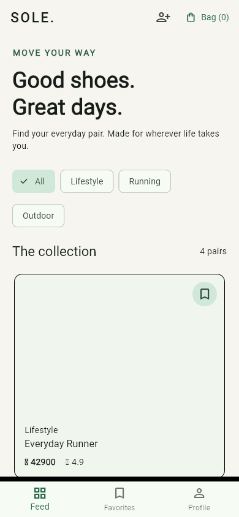

# SOLE — Sneaker Store

Flutter capstone MVP және LAB 5–7: кроссовка таңдауды жеңілдететін мобильді дүкен.
Нысаналы пайдаланушылар — студенттер мен күнделікті аяқ киім іздейтін адамдар.

## Іске қосу

Flutter SDK орнатылған ортада осы қалтадан орындаңыз:

```sh
flutter pub get
flutter run -d chrome
```

Android телефон/эмулятор үшін `flutter devices`, кейін `flutter run -d DEVICE_ID`.

## Мүмкіндіктер

- Discovery: бейімделетін тауар карточкалары, категория сүзгісі.
- Detail: Stack мұқабасы және bookmark белгісі, Row тақырыбы, Wrap баға/рейтинг/тегтер.
- Sticky төменгі жолақ: SafeArea → Row → Expanded → Add to Cart.
- StatefulWidget және setState: таңдаулылар, EU өлшемі, себет саны.
- Bag терезесі: өлшем бойынша саны және жалпы бағасы.
- Offline PNG мұқабалары: жоба ішіндегі векторлық суреттен жасалған, желі қажет емес.

Деректер демонстрациялық. Себет пен таңдаулылар тек ағымдағы сессияда сақталады.
Төлем, REST API, база және BLoC кейінгі кезеңдерде қосылады.

## Құрылым

```text
lib/
  main.dart
  models/product.dart
  screens/discovery_screen.dart
  screens/product_detail_screen.dart
  screens/registration_screen.dart
  screens/profile_screen.dart
  widgets/product_art.dart
test/widget_test.dart
test/registration_test.dart
```

## Тексеру

```sh
flutter analyze
flutter test
flutter build web
```

Widget тесттері 280×568, 320×568, 390×844, 1024×768 және 1440×900 өлшемдерінде
екі экранды ашады, bookmark пен EU 41 өлшемін таңдайды, себетке қосады және
Bag ішіндегі санын тексереді. RenderFlex және басқа Flutter қателері тестті құлатады.
Нақты Android құрылғысында іске қосу бөлек тексерілуі керек.

## 3–5 минуттық қорғау

1. **Pitch (1 минут):** «SOLE студенттерге аяқ киімді категориямен қарап,
   ұнағанын сақтап, өлшемін таңдап, себетке жинауға көмектеседі».
2. **Demo (2 минут):** Discovery → категория → тауар → bookmark → EU 41 →
   Add to Cart → артқа → Bag. Терезе енін өзгертіп, бейімделуін көрсетіңіз.
3. **Code review (1 минут):** screens/widgets/models құрылымын, Stack,
   Wrap, Expanded және setState қолданылған жерлерді көрсетіңіз.
4. **Даму жоспары:** REST каталогы, жергілікті сақтау, BLoC, авторизация және checkout.

## LAB 6 — User Registration & Profile Setup

Discovery үстіндегі **Create account** белгісін басыңыз.

- Form және GlobalKey<FormState> батырма басылғанда барлық өрісті тексереді.
- TextEditingController: Full Name, Email, Password және Confirm Password.
- Full Name бос/тек бос орын болса қабылданбайды.
- Email ішінде @ және домен нүктесі болуы керек; бос орындар мен қате құрылым қабылданбайды.
- Password кемінде 6 таңба; екі пароль өрісі obscureText арқылы жасырылған.
- Confirm Password дәл сәйкес болуы керек. Password өзгерсе, растау қайта тексеріледі.
- AutovalidateMode енгізу кезінде қателерді көрсетеді; submit барлық өрісті тексереді.
- Dropdown: Student / Teacher / Developer.
- Terms and Conditions checkbox белгіленбейінше тіркелу орындалмайды.
- Сәтті submit: terminal/debug console деректері және success SnackBar.
  Парольдер терминалда [REDACTED] деп көрсетіледі.
- Controller ресурстары dispose арқылы босатылады.

Бұл UI демонстрациясы: аккаунт серверде жасалмайды, деректер сақталмайды.
Registration тесттері міндетті өрістерді, live тексеруді, пароль өзгергендегі
сәйкестікті, checkbox талабын, сәтті submit пен рөлді тексереді.
280×568, 390×844 және 1440×900 өлшемдерінде форма overflow бермейді.
Жалпы 10 widget тесті өтті; flutter analyze қате таппады.
## LAB 7 — Navigation & Tabs

- Root экранда **BottomNavigationBar**: Feed / Favorites / Profile.
- Feed төрт тауарды суретімен, атауымен және бағасымен көрсетеді.
- Bookmark басқанда тауар Favorites қойындысына бірден қосылады/алынады.
- Profile: қонақ профилі, сессияда сақталатын баптау және LAB 6 формасына өту.
- IndexedStack және жеке ScrollController қойындылардың күйін сақтайды.
- `Navigator.push` арқылы толық Product объектісі detail конструкторына және
  `RouteSettings.arguments` ішіне беріледі: name, description, imageAsset, price, category, color.
- Detail AppBar Back және экран ішіндегі **Back to collection** батырмалары
  `Navigator.pop(context)` шақырады. Категория, favorites, себет және tab күйі сақталады.
- Product мұқабалары `assets/products/` ішінде, интернетсіз ашылады.

Соңғы тексеру: **14 widget тесті өтті**, lutter analyze --no-pub — қате жоқ,
Web build сәтті. Физикалық Android құрылғысы тексерілмеген.

### Қысқа бейнежазба

[MP4 жазбасын ашу](docs/lab7-navigation.mp4) · [GIF нұсқасы](docs/lab7-navigation.gif)



Бұл 390×844 өлшеміндегі Flutter қолданбасының автоматты UI сценарийінен алынған
нақты рендер кадрлары: Feed → Detail → bookmark → экран ішіндегі Back → Favorites
→ Detail → AppBar Back → Profile → баптау → Feed. Ұзақтығы шамамен 16 секунд.
Физикалық телефоннан түсірілген видео емес.

Жазбаны қайта жасау:

```sh
flutter test tool/record_navigation_test.dart
python -m pip install Pillow imageio-ffmpeg
python tool/encode_recording.py
```
## GitHub

Репозиторий: [ordabekuly/sole-store](https://github.com/ordabekuly/sole-store).
Репозиторий public: код пен README сілтемесі бар кез келген адамға ашық.

```sh
git clone https://github.com/ordabekuly/sole-store.git
cd sole-store
flutter pub get
flutter run -d chrome
```

Келесі өзгерістерді жіберу:

```sh
git add .
git commit -m "feat: describe your change"
git push
```

## LW8 — Smart Catalog

Open **Profile → LW8 Smart Catalog**.

- ListView.separated renders rows lazily; GridView.builder shares the same data.
- The grid has two columns and childAspectRatio: 0.72.
- Pull down either view to refresh. AlwaysScrollableScrollPhysics enables this even for short/empty catalogs.
- Refresh waits 1500 ms, then inserts a uniquely identified product at index 0.
- In List view, swipe right-to-left to delete. Dismissible uses ValueKey(product.id).
- The floating SnackBar offers UNDO, restoring the original index (clamped if the collection changed).
- Empty catalogs show Catalog is Empty and Reset Catalog.
- Reset restores the four original items. Changes are session-only; no server request is sent.

Files: lib/models/catalog_product.dart, lib/widgets/catalog_tile.dart,
lib/screens/smart_catalog_screen.dart, lib/screens/profile_screen.dart.

Defense: builders construct visible children on demand; a large Column constructs all children
at once. A stable ID key identifies the product after removal/insertion, whereas an index key
can refer to a different product when the collection changes. Future.delayed simulates network latency.

## LW9 — Global Cart with Provider

Open **Profile → LW9 Global Cart**. Select from six products, then tap the AppBar
cart badge to open Cart View. Remove one product or Clear All and return:
selection toggles, badge count and total immediately reflect the shared state.

- lib/providers/cart_provider.dart: CartProvider extends ChangeNotifier;
  immutable public item list, count, totalPrice, toggle/remove/clear and notifyListeners.
- lib/main.dart: ChangeNotifierProvider wraps MaterialApp, so pushed routes share
  one provider instance. context.watch rebuilds readers; context.read handles actions.
- lib/screens/global_catalog_screen.dart: six products, selection toggles, live Badge.
- lib/screens/global_cart_screen.dart: selected products, remove buttons, total and Clear All.
- test/global_cart_test.dart: provider behavior, route access, cross-screen sync and
  280/390/1440 layouts. Prices are integer KZT. Selection is session-only, without quantities.

LW9 is a separate teaching flow; the earlier size/quantity-based LAB 5 demo Bag remains separate.
Provider reference: https://pub.dev/packages/provider
